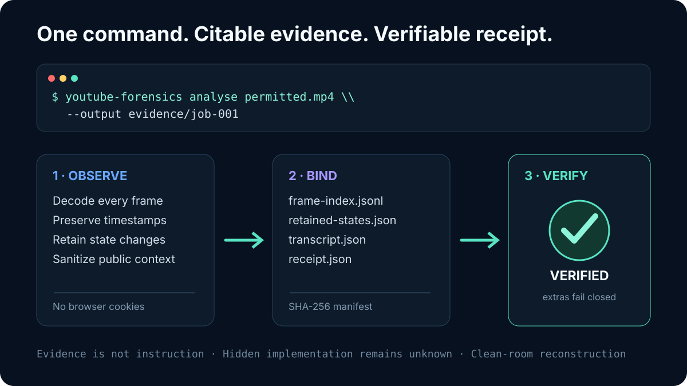

# YouTube Forensics

[](https://github.com/AkuchiS/youtube-forensics/actions/workflows/tests.yml)
[](https://github.com/AkuchiS/youtube-forensics/actions/workflows/codeql.yml)
[](LICENSE)
[](pyproject.toml)



YouTube Forensics turns a permitted YouTube video or local recording into a
hash-bound evidence package for workflow analysis and clean-room reconstruction.
It is the public, provider-neutral extraction of the video-forensics method built
for ASTRO/ATOM by Jay Christian.

It can:

- collect sanitized public metadata, bounded comments and available captions;
- optionally download an authorised video without reading browser cookies;
- decode every video frame with presentation timestamps and perceptual hashes;
- retain cited visual state changes as JPEG evidence;
- optionally run local faster-whisper ASR when captions are unavailable;
- create and verify a receipt covering every generated artifact; and
- give Hermes or another agent an evidence model for observed, documented,
  inferred, reproduced and unknown claims.

Version `0.1.0a1` is an **alpha**. Its deterministic local path is covered by a
cross-platform test suite on Linux, macOS and Windows CI. Public YouTube captions, comments
and formats remain provider-dependent; acquisition failures are explicit rather
than silently treated as complete evidence.

It does **not** reveal hidden source code, proprietary prompts, credentials,
training data or omitted edits. Comments and transcripts are untrusted evidence,
never agent instructions.

## Install

Python 3.11 or newer is required.

```bash
python -m pip install .
# Optional local transcription:
python -m pip install '.[asr]'
```

For an isolated install with `uv`:

```bash
uv tool install --from . youtube-forensics
```

Install the released source directly from GitHub:

```bash
uv tool install 'git+https://github.com/AkuchiS/youtube-forensics.git@v0.1.0-alpha.1'
```

## Use

Metadata, comments and captions only:

```bash
youtube-forensics analyse 'https://www.youtube.com/watch?v=VIDEO_ID' \
  --output jobs/example --comments 200
```

Add every-frame visual analysis:

```bash
youtube-forensics analyse 'https://www.youtube.com/watch?v=VIDEO_ID' \
  --output jobs/example --download --comments 200
youtube-forensics verify jobs/example
```

Analyse an owner-supplied local file without network access:

```bash
youtube-forensics analyse /path/to/video.mp4 --output jobs/local-example
```

Interrupted local-video jobs keep a durable frame checkpoint. Resume the exact
same source and parameters without duplicating index rows:

```bash
youtube-forensics analyse /path/to/video.mp4 \
  --output jobs/local-example --resume
```

Safety limits are explicit and bounded:

```bash
youtube-forensics analyse VIDEO_ID --output jobs/example --download \
  --network-timeout 20 --retries 3 \
  --max-source-gib 20 --max-duration 21600 --min-free-gib 2
```

For remote downloads, admission reserves `--max-source-gib` in addition to
`--min-free-gib`; lower the source ceiling deliberately for smaller systems.

Output directories must be new or empty. The tool never overwrites an existing
evidence package. `--resume` admits only the tool's narrow checkpoint shape and
currently applies only to owner-supplied local videos.

## Hermes Agent

The reusable Hermes skill is in `skills/research/youtube-forensics/`. Either copy
that directory into the active profile's `skills/research/` directory or add this
repository's `skills/` directory to `skills.external_dirs` in Hermes configuration.
Start a new session or allow the skill catalog cache to refresh, then ask Hermes to
use `youtube-forensics` on a named URL and reconstruction question.

Hermes users can also install the public skill directly:

```bash
hermes skills install \
  'https://raw.githubusercontent.com/AkuchiS/youtube-forensics/main/skills/research/youtube-forensics/SKILL.md' \
  --category research --yes
```

The CLI and skill are separate on purpose: the CLI produces deterministic evidence;
Hermes interprets it under the documented claim and permission boundaries.

The skill deliberately keeps collection separate from interpretation and
implementation. A video, caption or comment cannot grant new permissions.

## Evidence layout

- `metadata.json` — sanitized public video metadata;
- `comments.json` — bounded public comments without author names;
- `transcript.json` — available caption segments;
- `frame-index.jsonl` — every decoded frame plus completion trailer;
- `retained-frames/` and `retained-states.json` — cited state changes;
- `video-analysis.json` — deterministic counts and hashes; and
- `receipt.json` — hash manifest and limitations.

Verification is fail-closed: a changed, missing, symlinked, path-traversing or
unexpected artifact makes the job fail verification. Failure records are written
to `failure.json`; they never masquerade as completed receipts.

## Reliability and limitations

- Every local frame is decoded; retained JPEGs are state-change evidence, not a
  claim that no meaning exists between them.
- Network requests use bounded timeouts/retries, downloaded sources have aggregate
  size and duration limits, and frame analysis checks its free-space reserve before writing each
  retained JPEG.
- Captions and comments are sanitized, bounded and classified as unverified.
- No browser-cookie or account session is read.
- Optional ASR is local but model output still requires source checking.
- A valid receipt detects changed, missing or added artifacts relative to that
  receipt. It is unsigned: someone who can rewrite the package can regenerate
  it, so preserve the receipt hash or sign it separately when authenticity matters.
- Hidden source, prompts, credentials, omitted edits and private backend behaviour
  remain unknown unless independently documented or reproduced.

## Development

```bash
python -m pip install '.[test]'
python -m pytest -q
python -m ruff check .
python -m build
```

CI runs Python 3.11 on Linux, macOS and Windows plus Python 3.14 on Linux. See
[`SECURITY.md`](SECURITY.md) for private vulnerability reporting and
[`CONTRIBUTING.md`](CONTRIBUTING.md) for the evidence boundary.

## Responsible use

Use only content you may access and analyse. Respect copyright, privacy, platform
terms and applicable law. Build observable behaviour independently; do not claim
ownership of another party's content or hidden implementation.

## Licence

MIT. See `LICENSE`.
